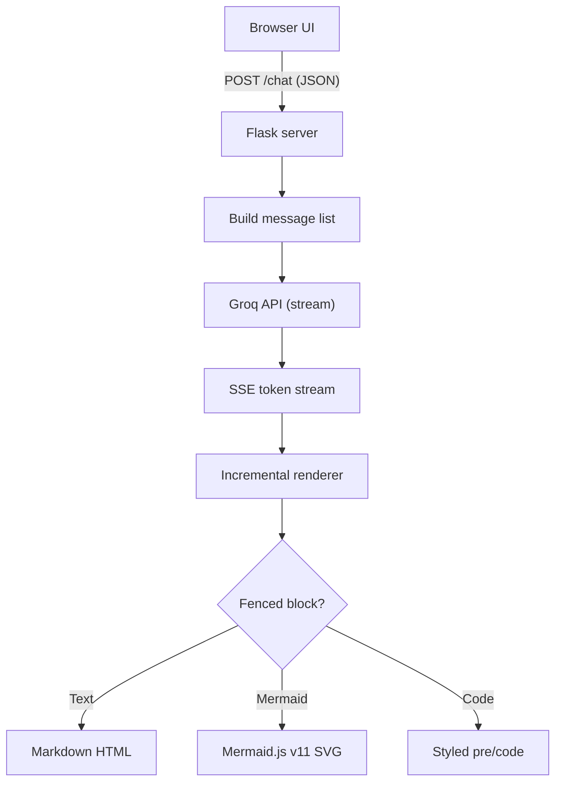

# Professor AI

An AI teaching assistant that explains any topic like a great teacher would — in ultra-simple language, backed by a **professional Mermaid flowchart**, a concrete example, and crisp key takeaways. Built with Flask + Groq and a zero-jank streaming UI.

---

## Highlights

- **Structured pedagogy** — every answer follows the same reliable format: Layman Explanation → Flowchart → Example → Key Takeaways
- **Real Mermaid diagrams** — flowcharts are rendered with Mermaid.js v11 (dark theme, responsive, zoom-friendly), not text dumps
- **Smooth token streaming** — server-sent events with incremental DOM rendering: finished sections are sealed and never re-rendered, only the growing tail updates (throttled to animation frames)
- **Distraction-free reading** — the viewport never auto-scrolls while a response streams; you stay in control
- **Conversation memory** — last 10 turns are sent as context so follow-up questions make sense
- **One-click examples** — starter chips for common topics

---

## Architecture



---

## Tech Stack

| Layer     | Technology                          |
|-----------|-------------------------------------|
| Backend   | Flask, Python 3.10+                 |
| AI        | Groq API (`openai/gpt-oss-20b`)     |
| Frontend  | Vanilla JS, HTML, CSS (no framework)|
| Diagrams  | Mermaid.js v11 (CDN)                |
| Transport | Server-Sent Events (text/event-stream) |

---

## Quick Start

### 1. Clone and enter the project

```bash
git clone <your-repo-url>
cd professor-ai
```

### 2. Create a virtual environment

```bash
python -m venv venv

# Windows
venv\Scripts\activate

# macOS / Linux
source venv/bin/activate
```

### 3. Install dependencies

```bash
pip install -r requirements.txt
```

### 4. Configure your API key

Create a `.env` file in the project root:

```env
GROQ_API_KEY=your_groq_api_key_here
```

Get a free key at [console.groq.com/keys](https://console.groq.com/keys).

### 5. Run

```bash
python main.py
```

Open **http://127.0.0.1:5000** in your browser.

---

## Project Structure

```
professor-ai/
├── main.py               # Flask app, Groq streaming, system prompt
├── templates/
│   └── index.html        # Chat UI, Mermaid rendering, streaming logic
├── requirements.txt
├── .env                  # API key (never commit)
└── README.md
```

---

## API

### `GET /`

Serves the chat interface.

### `POST /chat`

Streams the assistant response as Server-Sent Events.

**Request body**

```json
{
  "message": "How does DNS work?",
  "history": [
    { "role": "user", "content": "previous question" },
    { "role": "assistant", "content": "previous answer" }
  ]
}
```

`history` is optional; only the last 10 turns are used.

**Stream events**

```text
data: {"token": "##"}

data: {"token": " 🧑‍🏫 Layman Explanation"}

data: {"done": true}
```

Errors are reported in-band:

```text
data: {"error": "Rate limit reached. Try again shortly."}
```

---

## How Streaming Stays Smooth

1. **Segment the text** — the accumulated response is split into text, code fence, and Mermaid segments
2. **Seal completed segments** — once a segment is complete it is rendered once and never touched again
3. **Update only the tail** — the in-progress segment is re-rendered at most once per animation frame
4. **Cache diagram renders** — each Mermaid block renders to SVG exactly once; the final render reuses the same SVG, so nothing shifts when the stream completes
5. **No forced scrolling** — the viewport only jumps when you send a message (or on error)

---

## Customization

| What                    | Where                          | How                                          |
|-------------------------|--------------------------------|----------------------------------------------|
| Model                   | `main.py` → `MODEL`            | Any Groq-hosted chat model                   |
| Answer format           | `main.py` → `SYSTEM_PROMPT`    | Add/remove sections or change the flowchart  |
| Diagram theme/colors    | `index.html` → `themeVariables`| Mermaid base theme variables                 |
| Conversation depth      | `main.py` → `history[-10:]`    | Raise or lower the context window            |
| Port                    | `main.py` → `app.run(...)`     | Change `port=5000`                           |

---

## Troubleshooting

| Symptom | Fix |
|---------|-----|
| `GROQ_API_KEY missing` | Ensure `.env` exists in the project root and the key is valid |
| `Rate limit reached` | Groq free tier is throttled — wait a few seconds and retry |
| `Could not reach Groq API` | Check your internet connection / firewall |
| Flowchart shows an error box | The model emitted invalid Mermaid; retry — the prompt constrains syntax strictly |
| Blank page / no streaming | Hard-refresh (Ctrl+Shift+R) to bypass cache; confirm Mermaid CDN is reachable |

---

## License

MIT — use it, learn from it, make it your own.
